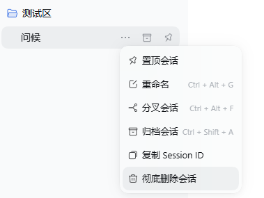
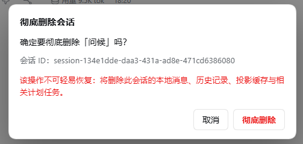
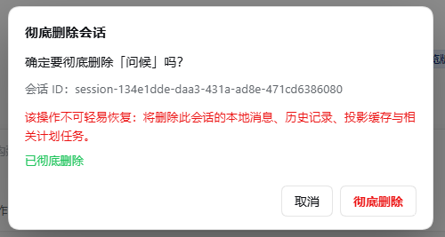

# dsh-session-erase

为 DeepSeek Harness（Web GUI）增加「彻底删除会话」：会话行的 ⋯ 菜单与右键菜单均可触发；确认后通过宿主生命周期停止写入（flush → 释放 live Session → 等待 `session/disposed` 与投影缓存写回），确认会话不再 live 后才删除本地持久化数据。

> **该操作不可逆。** 请先阅读「删除范围与不可恢复风险」。

## 功能

- 会话行 ⋯ 菜单与右键菜单中的「彻底删除会话」（带垃圾桶图标）。
- 二次确认框显示会话标题与 Session ID，并显示处理中、失败原因与重试。
- 删除成功后自动刷新会话列表。
- 跟随 Harness 当前主题（亮色 / 暗色）。

## 截图

### 快捷菜单



### 确认对话框



### 删除结果




## 组成

| 文件 | 作用 |
|---|---|
| `lib/index.js` | 宿主半侧：注册 `POST /api/session-erase`（经 Connection 的认证 fetch 路由） |
| `lib/erase.js` | 删除引擎：存在性校验 → 停止写入 → 释放 live Session → 删除 → 逐位置验证 |
| `lib/paths.js` | 路径编码与包含校验 |
| `lib/client.js` | 浏览器半侧：菜单项、右键菜单、确认框、主题适配 |
| `cordis.patch.yml` | bundle patch：插入插件行，`sessionsRoot` 由 `!!js dshHomePath('sessions')` 提供 |
| `tools/verify-session-gone.mjs` | 只读验证器：确认某 Session ID 的磁盘记录已不存在 |
| `test/*.test.mjs` | 单元/集成测试（`node:test`，无外部依赖） |

## 安装

### GUI（推荐）

1. 侧边栏 →「插件」页 → 安装组合包，选择本插件的本地目录（绝对路径）。
2. 若安装后只出现依赖而未启用，在组合包列表中启用本插件（名称以 `package.json` 为准）。
3. HMR 会热组合；若页面未出现菜单，刷新页面一次。

### 手动（本地 link）

在 Harness profile 目录的 `package.json` 中把本目录加入 `dependencies`（`link:<绝对路径>`）并加入 `dsh.profile.bundles`，然后在该目录执行 `pnpm install`。该方式会修改 profile，请自行确认。

## 卸载 / 回滚

- GUI：插件页停用并移除组合包。
- 手动：从 `dsh.profile.bundles` 与 `dependencies` 中移除本包，删除对应的 `node_modules` 链接，重启 Harness。
- 卸载不会删除任何已存在的会话数据。

## 兼容性

- 在 Windows 桌面版 DeepSeek Harness **0.2.1-rc.3** 上开发并实测。
- 未在其他 DSH 版本验证；`package.json` 的 `engines.dsh` 只是安装期声明，超出实测版本的兼容性不作保证。

## 测试

```powershell
node test/paths.test.mjs
node test/erase.test.mjs
node test/client.test.mjs
```

说明：部分受限环境（如 DSH 沙箱）中 `node --test` 会因管道 stdio 报 `EPERM`，直接运行测试文件即可。

## 删除范围与不可恢复风险

删除（仅目标会话）：

- `~/.dsh/sessions/<project>/<id>/`（会话日志）；
- `~/.dsh/storages/session_projcache` 中该会话的记录；
- `~/.dsh/storages/schedule/tasks` 中绑定该会话的计划任务；
- `%TEMP%/dsh-spill-*/session-<hash>`（该会话的 spill 临时文件）。

只有在数据验证通过后，才清理 `~/.dsh/storages/workspace.json` 中该 id 的 workspace 记账、归档与置顶记录。

**不删除**（共享或不属于本插件管理）：

- `~/.dsh/attachments/v1`（内容寻址，可能被多个会话引用）；
- `~/.dsh/cache/attachments`；
- 模型 / API 配置、其他会话与工作区、Harness 主程序。

**无法保证物理擦除**：SSD 磨损均衡、文件系统快照、系统备份、云同步副本，以及已发送给模型提供方的请求内容（服务端保留策略不受本插件控制）。

## 安全设计（当前实现）

- **活动会话**：目标仍 live 时，先 `flush`，再通过 `liveEntryFor(session).detach()` 释放，等待 `session/disposed` 与投影缓存写回，并确认 `sessions.get(id)` 已不存在后才删除目录；任一步失败即中止且不删除任何文件。
- **不改变归档状态**：删除前不调用 `archiveSession`；使用 `workspace/session-stop` 停止 turn / 子代理 / 后台任务 / 计划任务。
- **幂等 detach**：对每个 workspace 无条件调用 `detachSession(id)`。
- **失败关闭**：必需服务缺失、会话根目录不可读、`workspace.json` 不可读或解析失败、删除失败、最终验证不通过，均返回明确错误，绝不报告成功。
- **验证读真实持久化状态**：`workspace.json` 直接解析、会话目录实际扫描；`ok: true` 必须满足 `verification.allClear === true`。
- **范围受控**：Session ID 经正则校验 + 路径编码 + 包含校验；共享附件不进入删除集合。

## 隐私

除向本机 DeepSeek Harness 宿主发起删除操作所需的请求外，本插件不主动向外部网络发送请求，不上报遥测数据，也不收集或上传用户数据。删除操作涉及的数据访问范围及行为详见上文的删除流程与风险说明。

## 许可证

MIT，见 [LICENSE](LICENSE)。Copyright (c) 2026 Misty。
